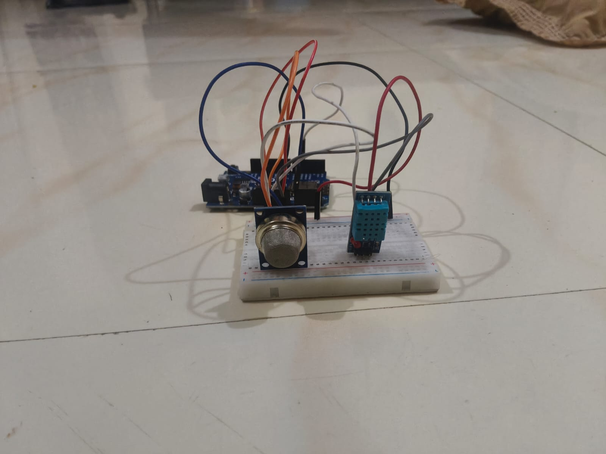
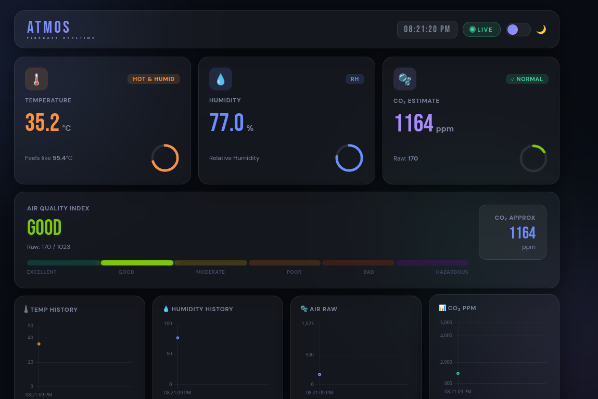

# ATMOS Pocket Weather Station

ATMOS is an ESP8266-based weather and air-quality monitoring project. Sensors connected to a WeMos D1 R1 measure local conditions and send readings to Firebase Realtime Database. A browser dashboard listens for updates and displays the readings in real time.

## What it monitors

- Temperature, relative humidity, and heat index from a DHT11.
- Air-quality sensor output from an MQ135, including a raw analog reading and a mapped ppm estimate.
- Rain detected by a digital rain sensor.
- Comfort and air-quality labels, plus a gas alert when the raw MQ135 reading is above the firmware threshold.

The MQ135 ppm value is a rough mapping of its analog reading, not a calibrated or certified gas concentration.

## Hardware

| Component | Connection |
| --- | --- |
| WeMos D1 R1 (ESP8266) | Controller and Wi-Fi |
| DHT11 | Digital pin D5 |
| MQ135 | Analog input A0 |
| Rain sensor | Digital pin D6 |

Check the voltage and pin requirements for your exact sensor modules and board before wiring.

## How it works

1. The ESP8266 connects to Wi-Fi and Firebase.
2. Every five seconds, the firmware reads the sensors and writes a JSON object to the `/sensorData` path in Realtime Database.
3. The web dashboard subscribes to that path and updates when new data arrives.

The database object contains `temp`, `hum`, `feels`, `ppm`, `airRaw`, `airQuality`, `comfort`, `rain`, and `gasAlert`.

The dashboard shows the latest readings, connection status, air-quality and comfort indicators, and charts for temperature, humidity, raw air-sensor output, and estimated ppm. Charts retain up to 20 recent readings in the browser. The interface also includes dark/light themes and rain and high-temperature visual alerts; rain detection can play `rainStart.mp3`.

## Software

- Arduino IDE or another ESP8266-compatible build environment
- ESP8266 board support for the WeMos D1 R1
- Arduino libraries: `Firebase_ESP_Client` and `DHT`
- A Firebase project with Realtime Database
- A modern browser and a local or hosted static web server

The frontend loads Firebase JavaScript SDK 10.7.1 and Chart.js 4.4.1 from public CDNs.

## Setup

### Configure and upload the firmware

1. Install the ESP8266 board support and the libraries listed above.
2. Open `atmos.ino`.
3. Replace `YOUR_WIFI_SSID`, `YOUR_WIFI_PASSWORD`, `YOUR_FIREBASE_API_KEY`, and `YOUR_FIREBASE_DATABASE_URL` with your own configuration.
4. Confirm the sensor wiring matches the pin definitions in the sketch, then select the correct board and upload.

### Configure and run the dashboard

1. In `app.js`, set `firebaseConfig` to the web app configuration for the same Firebase project used by the firmware.
2. Configure Realtime Database access so the firmware can write sensor data and the dashboard can read it. Use appropriately restricted rules; do not leave test or public write access enabled for deployment.
3. Serve the project root over HTTP, then open `index.html` in a browser. For example, from the project directory run `python -m http.server 8000` and visit `http://localhost:8000`.
4. Confirm that the Firebase connection status changes to **LIVE** after the firmware starts uploading readings.

## Dashboard preview

